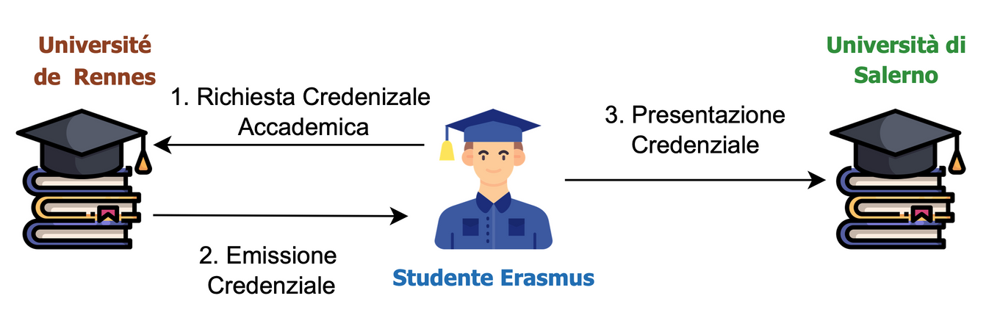
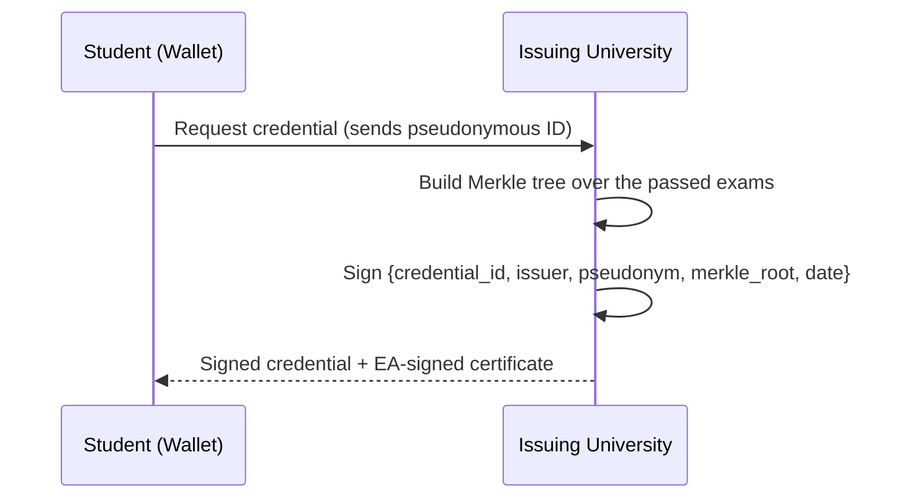
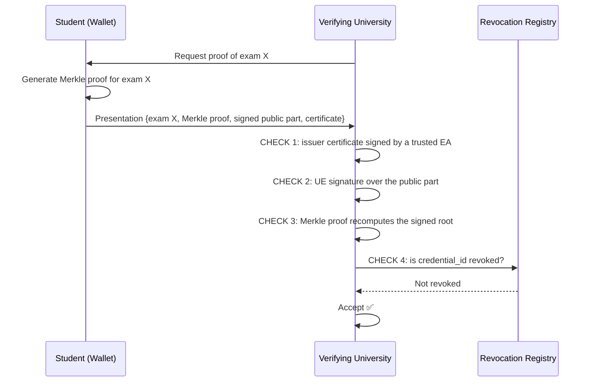
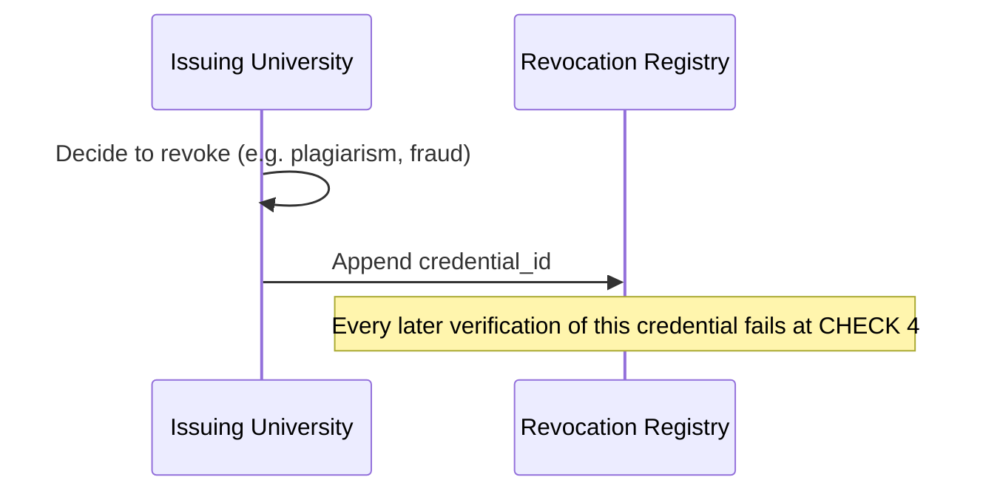

<div align="center">

# 🎓 Selective Disclosure & Revocation of Academic Credentials

**A privacy-preserving system that lets Erasmus students share only the exams they choose, verifiable without contacting the issuing university**


*Project work for **Algorithms and Protocols for Security**, MSc in Computer Engineering, University of Salerno (a.y. 2024/2025)*



</div>

---

## 📌 The problem

When an Erasmus student comes home, they have to prove which exams they passed abroad. Today that usually means signed PDFs exchanged by email or through centralized, non-interoperable systems that:

- require trusting a central authority to verify documents;
- force the student to reveal **more than necessary** (the whole transcript instead of a single exam);
- offer no clear, decentralized way to **revoke** a credential (for plagiarism, document fraud or administrative errors).

**Goal:** design a decentralized mechanism for the **selective sharing and revocation** of academic credentials. It should be light enough to run on resource-constrained devices such as hardware wallets.

**Example scenario:** a student from the University of Salerno spends a semester at the Université de Rennes. Rennes issues a credential with all the exams passed. The student then shows Salerno **only the exams to be recognized**. Salerno verifies them on its own, without contacting Rennes, and can check at any time whether the credential has been revoked.

---

## 🧩 Project structure: the 4 work packages

| WP | Content |
|---|---|
| **WP1: Model** | Honest actors, threat model with 6 classes of adversaries, security, privacy and resilience properties, credential structure |
| **WP2: Solution** | Protocols for issuance, selective presentation, verification and revocation |
| **WP3: Security analysis** | How the design withstands each adversary from WP1 |
| **WP4: Implementation** | Python prototype with GUI, attack simulations and performance benchmark |

### Actors
- **Student (S):** holds the credentials in a personal wallet and decides what to reveal, to whom and when
- **Issuing University (UE):** Université de Rennes; creates and signs credentials
- **Verifying University (UV):** Università di Salerno; verifies presentations without contacting the issuer
- **Accreditation Authority (EA):** certifies the issuing universities' public keys

### Threat model
External attacker · Malicious student · Malicious insider · Network attacker (MitM, replay) · Honest-but-curious verifier (profiling) · Faulty or malicious issuer

---

## 🔐 How it works

### Cryptographic building blocks

| Need | Solution |
|---|---|
| Authenticity, integrity, non-repudiation | **RSA-2048 digital signatures** (PSS padding, SHA-256) |
| Trust in issuers | **Accreditation Authority** signs each university's public key (certificate chain) |
| Selective disclosure | **Merkle tree**: each exam is a leaf, the issuer signs only the **Merkle root** |
| Pseudonymous identity (DID-like) | Student identifier = **SHA-256 hash of the wallet's public key** |
| Public revocation | **Append-only revocation registry** (DLT simulated with a local JSON file) |

### Credential structure

```text
AcademicCredential
├── credential_id        UUID, also used for revocation
├── issuer_id            issuing university
├── student_pseudonym    SHA-256(student public key)
├── issue_date
├── merkle_root          commitment over all exams
├── courses[]            leaves: {id, nome, voto, cfu, data}  ← kept private in the wallet
├── issuer_certificate   UE public key signed by the Accreditation Authority
└── signature            UE signature over the public part
```

### 1️⃣ Issuance



### 2️⃣ Selective presentation & verification

The student reveals **one exam** plus its **Merkle proof**, meaning the sibling hashes needed to recompute the root. The other exams are never sent.



### 3️⃣ Revocation



---

## 🛡️ Attack simulations

`main.py` runs the full life cycle of a credential and a set of attack scenarios. Each one is caught by a specific check:

| Scenario | Expected result | Caught by |
|---|---|---|
| Honest student presents one exam | ✅ Accepted | n/a |
| **Tampering:** student raises a grade from 28 to 30 in the presentation | ❌ Rejected | CHECK 3: Merkle proof |
| **Revocation:** student reuses a revoked credential | ❌ Rejected | CHECK 4: revocation registry |
| **Forgery:** external attacker signs a fake credential with their own key | ❌ Rejected | CHECK 2: issuer signature |
| **Untrusted issuer:** university whose accreditation is no longer valid | ❌ Rejected | CHECK 1: EA certificate |

---

## 📊 Performance

Averages over **100 runs**, credentials with **10 exams** each (`benchmarck.py`):

| Operation | Avg latency | Std dev |
|---|---:|---:|
| Credential issuance | 1.330 ms | 0.248 ms |
| Presentation generation | 0.140 ms | 0.073 ms |
| Full verification (4 checks) | 0.251 ms | 0.112 ms |

| Object | Size (JSON) |
|---|---:|
| Full credential | 2.50 KB |
| Selective presentation | 2.46 KB |

Each operation takes about a millisecond and every object stays within a few kilobytes, which suits the resource-constrained devices (e.g. hardware wallets) required by the assignment. Most of a presentation's size comes from the issuer certificate and the RSA signature. The Merkle proof grows only **logarithmically** with the number of exams.

---

## 🖥️ Graphical interface

A **Tkinter** GUI simulates the three main actors, each with its own login and dedicated view:

- **Student:** browse credentials in the wallet, pick an exam, generate a presentation
- **Issuing University:** issue new credentials and revoke existing ones
- **Verifying University:** inspect received presentations and run the verification checks

<!-- TODO: add GUI screenshots, e.g. assets/gui_student.png, assets/gui_verifier.png -->

Demo accounts (password `forzalupi`):

| Role | E-mail |
|---|---|
| Student | `student@uni.com` · `student2@uni.com` |
| Issuing University | `issuer@uni.com` |
| Verifying University | `verifier@uni.com` |

---

## 🚀 Getting started

```bash
git clone https://github.com/LeonardoLuongo/APS-Project-Work.git
cd APS-Project-Work

conda create -n aps-pw-env python=3.10
conda activate aps-pw-env
pip install cryptography          # tkinter ships with most Python installations

cd src/python
python main.py          # CLI simulation: full life cycle + attack scenarios
python gui.py           # graphical interface
python benchmarck.py    # performance benchmark
```

---

## 📁 Repository structure

```
src/python/
├── AccreditationAuthority/   # EA: certifies issuers' public keys
├── IssuingUniversity/        # issues and revokes credentials
├── Student/                  # student and wallet (selective presentations)
├── VerifyingUniversity/      # 4-step verification
├── Revocation/               # append-only revocation registry (simulated DLT)
├── utils/
│   ├── crypto_utils.py       # RSA-PSS signatures, SHA-256 hashing
│   ├── merkle_tree.py        # Merkle tree, proof generation and verification
│   └── credential.py         # AcademicCredential
├── models.py                 # dataclasses: Certificate, VerifiablePresentation, …
├── main.py                   # CLI simulation
├── gui.py                    # Tkinter GUI
└── benchmarck.py             # performance benchmark
```

---

## 🔭 Design trade-offs & future work

The prototype trades some of the properties from WP1 for implementation simplicity:

- **Merkle tree instead of Zero-Knowledge Proofs.** Merkle proofs give selective disclosure, integrity and non-repudiation with standard primitives. However, presentations of the same credential share the same `credential_id`, pseudonym and signature, so they are **linkable**. Signature schemes such as **BBS+** would provide unlinkable selective disclosure.
- **Salted leaves.** Adding a random salt to each Merkle leaf would stop a verifier from guessing the content of hidden, low-entropy exams from the sibling hashes.
- **Real DLT.** The revocation registry would become a **smart contract** (e.g. on Ethereum). Revocations happen on-chain and are publicly verifiable. Issuance and presentation stay off-chain to protect privacy and keep costs down.
- **Expiry dates** and an **audit log** of administrative actions (insider-threat mitigation) are designed in WP1/WP2 but not yet implemented.

---

## 👥 Team (Group 11)

| Member | Responsibilities |
|---|---|
| **Leonardo Luongo** ([@LeonardoLuongo](https://github.com/LeonardoLuongo)) | WP1 Model · WP4 Implementation |
| **Francesco Monda** ([@cescomonda](https://github.com/cescomonda)) | WP2 Solution · WP3 Security analysis |

## 🎓 Acknowledgements

Course held by **Prof. Carlo Mazzocca** and **Prof. Francesco Cauteruccio**, University of Salerno.
